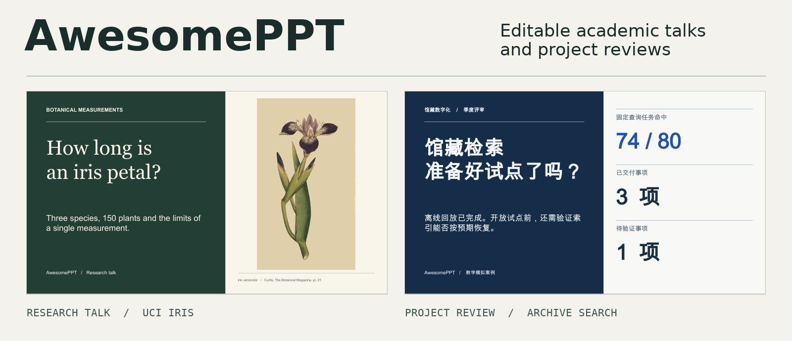
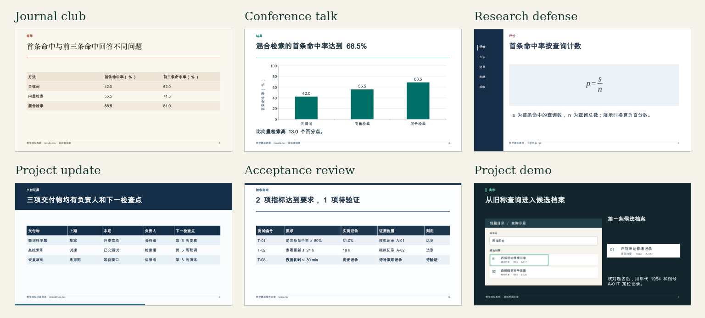

# AwesomePPT

[](docs/gallery.md)

**English** · [简体中文](README.zh-CN.md)　|　[Sample talk](docs/decks/iris.pdf) · [Template gallery](docs/gallery.md) · [Agent skill](research-deck/SKILL.md) · [Verification](https://github.com/asimfish/awesome-ppt/actions/workflows/verify.yml)

AwesomePPT turns research notes, papers and project records into editable PowerPoint talks. Give your agent a brief and your sources. It writes a slide plan, links quantitative claims to named rows and columns, and renders a deck with native charts, tables and speaker notes. The renderer runs locally.

## Open the decks

| Presentation | What to look for | Files |
|---|---|---|
| Research talk · How long is an iris petal? | A botanical plate opens the talk. A dot plot shows all 150 plants before the means and overlapping ranges are compared. | [Editable PPTX](docs/decks/iris.pptx) · [PDF](docs/decks/iris.pdf) · [Sources](examples/iris/SOURCE.md) |
| Project review · Is archive search ready for a pilot? | A Chinese quarterly review opens with three deliveries and one unresolved check. Paired grids show the results of 80 replay tasks. The closing slide names the decision, owner and evidence required. The project records are illustrative. | [Editable PPTX](docs/decks/project-review.pptx) · [PDF](docs/decks/project-review.pdf) · [Slide plan and ledger](examples/project-review) |

## Built to extend GPT-6.2 Astra’s slide workflow

OpenAI’s release highlights how GPT-6.2 Astra designs slides and follows the layout, colors and typography of a supplied file or screenshot. AwesomePPT brings reusable institutional templates, row-level data binding, native PowerPoint objects and rendered checks to that workflow. For a quarterly review, give Astra last quarter’s deck and this quarter’s records, then invoke `$research-deck` to preserve the roadmap and attach the evidence to each changed milestone. The renderer also works from a JSON plan with no model connection. [OpenAI release](https://openai.com/index/introducing-gpt-6-2-astra-sol/)

## University templates

Six campus starters cover a Peking University colloquium, Tsinghua research talk, Beihang engineering proposal, Fudan methods seminar, SJTU development review and Beijing Zhongguancun Academy quarterly defense. The catalog covers ten institutions and links to school resources. You can also import a native PowerPoint master. [Campus gallery and downloads](docs/campuses.md)

## Build your first deck

From a checkout of this repository, with Python 3.9 or newer:

```sh
python3 -m venv .venv
. .venv/bin/activate
python -m pip install -r research-deck/requirements.txt
python research-deck/scripts/deck.py build examples/iris/deck.json out/iris.pptx
```

Open `out/iris.pptx` in PowerPoint. To make a PDF, install LibreOffice and put `soffice` on your PATH, then run `python research-deck/scripts/deck.py preview out/iris.pptx out/iris.pdf`. Equation slides additionally require Pandoc and the LibreOffice Writer and Math components. On minimal Debian or Ubuntu installations, install both libreoffice-writer and libreoffice-math. The checked-in previews open without either tool.

## Reuse and check a talk

Inspect the storyboard before rendering. It shows the selected layout, sources and data rows for each slide. Omit `layout` to let the skill use the supplied evidence, or specify it to retain an author's design. Condition photographs can follow their CSV row keys, and workflow pages can show owners, actions and outputs. The iris example selects a chart for the means and explicitly requests a dot plot for individual observations.

```sh
python research-deck/scripts/deck.py storyboard examples/iris/deck.json
python research-deck/scripts/deck.py draft examples/iris/deck.json out/iris-work
python research-deck/scripts/deck.py check docs/decks/iris.pptx --spec out/iris-work/deck.json --pdf docs/decks/iris.pdf --overview out/iris-overview.pdf
```

The portable draft carries its CSVs, cover plate and figures. The check reports source discrepancies and highlights pages that need visual inspection. Native template edits can add an editable text box over a school master. [Iris slide overview](docs/decks/iris-overview.pdf) · [Editing and verification spec](research-deck/references/spec.md)

## Use it with an agent

The repository includes a project-scoped skill at `.agents/skills/research-deck`. Open this checkout in an agent that supports project skills, or copy the `research-deck/` directory into your agent's skills folder. Invoke it as `$research-deck`.

> Use $research-deck to turn this paper into a 12-minute journal club talk. Keep the original method figure, bind the main result to an editable chart, and leave one slide for the strongest limitation. Add speaker notes and figure or table numbers.

For an experimental sequence, place consecutive observations side by side and label the moment that changed the interpretation. For a paper-by-paper journal club, the reading guide follows the slide order and updates the page ranges when a paper gains or loses a slide. Numbered citations, speaker notes and the linked bibliography keep each result tied to its source. [Slide specification](research-deck/references/spec.md)

For a project review, provide the requirements and the test ledger. The acceptance starter links each test ID to its requirement, measured value, evidence location and status. A passing row with a missing measurement or record is flagged during the build. The reviewer verifies the underlying record and threshold.

## Choose a mode and a visual style

[](docs/gallery.md)

Pick a mode for the audience's question and a style for the room. Six narrative modes and nine general visual styles can be combined. There are six additional campus treatments. The Chinese starters are complete worked examples. The Iris talk is an English example.

```sh
python research-deck/scripts/deck.py starter acceptance review-work --style review
python research-deck/scripts/deck.py build review-work/deck.json out/review.pptx
```

Replace the sample data, slide text and notes with your own records before presenting. Existing institutional decks can be inspected and updated by object ID with an exact-text precondition. [Six downloadable starters](docs/gallery.md) · [Specification and template edits](research-deck/references/spec.md)

## Reproduce and contribute

`python examples/iris/summarize.py` rebuilds the example's CSV from its frozen input. `python research-deck/evals/test_deck.py` exercises data binding, acceptance evidence, editable objects and preservation of untouched template parts. CI also rebuilds the showcased talk and checks its projected values. [Contributor guide](CONTRIBUTING.md) · [Continuous integration](.github/workflows/verify.yml)

The project uses GNU AGPL version 3. The UCI Iris data carries CC BY 4.0 attribution. [Project license](LICENSE) · [Third-party materials](NOTICE.md)
