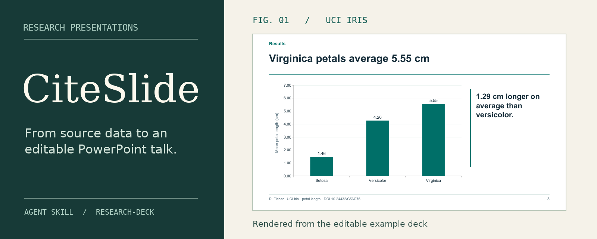

# CiteSlide · 引页

[](docs/decks/iris.pdf)

**English** · [简体中文](README.zh-CN.md)　|　[Sample talk](docs/decks/iris.pdf) · [Template gallery](docs/gallery.md) · [Agent skill](research-deck/SKILL.md) · [Verification](https://github.com/asimfish/citeslide-skill/actions/workflows/verify.yml)

CiteSlide turns research notes, papers and project records into editable PowerPoint talks. Give your agent a brief and your sources. It writes a slide plan, links quantitative claims to named rows and columns, and renders a deck with native charts, tables and speaker notes. The renderer runs locally.

## Open a real talk

In the five-slide Iris talk, the result slide says that virginica petals average **5.55 cm**. The bar, headline and notes refer to the same summary table. The next slide shows why group means alone cannot separate individual plants. Open the PPTX and select the chart to edit its data. [Editable talk](docs/decks/iris.pptx) · [PDF preview](docs/decks/iris.pdf) · [Slide plan](examples/iris/deck.json) · [Data and attribution](examples/iris/SOURCE.md)

## Build your first deck

From a checkout of this repository, with Python 3.9 or newer:

```sh
python3 -m venv .venv
. .venv/bin/activate
python -m pip install -r research-deck/requirements.txt
python research-deck/scripts/deck.py build examples/iris/deck.json out/iris.pptx
```

Open `out/iris.pptx` in PowerPoint. To make a PDF, install LibreOffice and put `soffice` on your PATH, then run `python research-deck/scripts/deck.py preview out/iris.pptx out/iris.pdf`. Equation slides additionally require Pandoc. The checked-in previews open without either tool.

## Use it with an agent

The repository includes a project-scoped skill at `.agents/skills/research-deck`. Open this checkout in an agent that supports project skills, or copy the `research-deck/` directory into your agent's skills folder. Invoke it as `$research-deck`.

> Use $research-deck to turn this paper into a 12-minute journal club talk. Keep the original method figure, bind the main result to an editable chart, and leave one slide for the strongest limitation. Add speaker notes and figure or table numbers.

For a project review, provide the requirements and the test ledger. The acceptance starter links each test ID to its requirement, measured value, evidence location and status. A passing row with a missing measurement or record is flagged during the build. The reviewer verifies the underlying record and threshold.

## Choose a mode and a visual style

[](docs/gallery.md)

Pick a mode for the audience's question and a style for the room. Six narrative modes and six visual styles can be combined. The Chinese starters are complete worked examples. The Iris talk is an English example.

```sh
python research-deck/scripts/deck.py starter acceptance review-work --style review
python research-deck/scripts/deck.py build review-work/deck.json out/review.pptx
```

Replace the sample data, slide text and notes with your own records before presenting. Existing institutional decks can be inspected and updated by object ID with an exact-text precondition. [Six downloadable starters](docs/gallery.md) · [Specification and template edits](research-deck/references/spec.md)

## Reproduce and contribute

`python examples/iris/summarize.py` rebuilds the example's CSV from its frozen input. `python research-deck/evals/test_deck.py` exercises data binding, acceptance evidence, editable objects and preservation of untouched template parts. CI also rebuilds the showcased talk and checks its projected values. [Contributor guide](CONTRIBUTING.md) · [Continuous integration](.github/workflows/verify.yml)

The project uses GNU AGPL version 3. The UCI Iris data carries CC BY 4.0 attribution. [Project license](LICENSE) · [Third-party materials](NOTICE.md)
