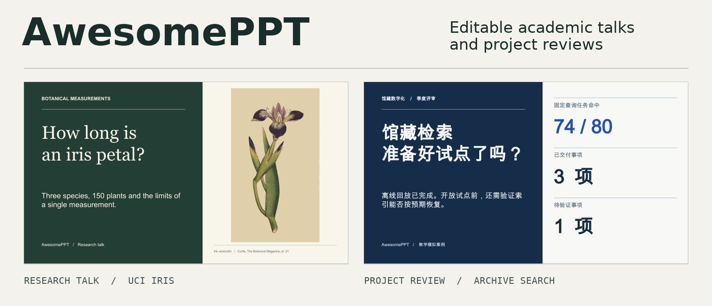
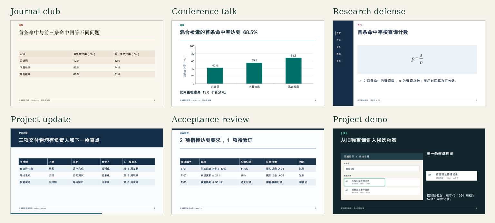

# AwesomePPT

[](docs/gallery.md)

[English](README.md) · **简体中文**　|　[查看样稿](docs/decks/iris.pdf) · [模板图册](docs/gallery.md) · [Skill 入口](research-deck/SKILL.md) · [持续集成](https://github.com/asimfish/awesome-ppt/actions/workflows/verify.yml)

AwesomePPT 帮你把论文、实验数据和项目记录讲成一份可编辑的 PowerPoint。向智能体说明听众、时间和材料，它会编排逐页主线，把定量结论绑定到具体数据行列，并写好讲者备注。PPTX 在本地生成。

## 先看成稿

| 场合 | 打开后可以看什么 | 文件 |
|---|---|---|
| 学术短讲 · 鸢尾花的花瓣有多长？ | 博物图版引入研究对象。逐株点图展示 150 次测量，均值图和取值范围解释为什么两个物种仍会重叠。 | [可编辑 PPTX](docs/decks/iris.pptx) · [PDF](docs/decks/iris.pdf) · [原始材料](examples/iris/SOURCE.md) |
| 中文项目评审 · 馆藏检索准备好试点了吗？ | 首页交代 3 项交付和 1 项待验证。两个方格图比较同一批 80 个查询任务，末页给出待批准的演练窗口、负责人和回执。使用教学模拟数据。 | [可编辑 PPTX](docs/decks/project-review.pptx) · [PDF](docs/decks/project-review.pdf) · [逐页稿与台账](examples/project-review) |

## 对 GPT-6.2 Astra 幻灯片工作流的增强

OpenAI 在 GPT-6.2 Astra 发布说明中专门展示了幻灯片设计，以及从原文件或截图跟随布局、配色和字体的能力。AwesomePPT 在这条工作流上补充高校场合模板、按行列绑定的数据、原生 PowerPoint 对象和渲染核验。例如，交给 Astra 上季答辩稿和本季台账，再调用 `$research-deck`，就能沿用同一张路线图，同时给变化的节点附上证据。已有逐页 JSON 时也可以直接本地构建。[OpenAI 官方发布说明](https://openai.com/zh-Hans-CN/index/introducing-gpt-6-2-astra-sol/)

## 高校与院校模板

可直接生成北大学术沙龙、清华科研进展、北航工程开题、复旦方法研讨、上海交大研制总结和北京中关村学院季度答辩六套可编辑起稿。高校目录共收录十所机构，也支持导入已有校方 PPTX。[高校图册、样稿与校方入口](docs/campuses.md)

## 在本机生成第一份 PPT

在仓库根目录，使用 Python 3.9 或更高版本运行以下命令。

```sh
python3 -m venv .venv
. .venv/bin/activate
python -m pip install -r research-deck/requirements.txt
python research-deck/scripts/deck.py build examples/iris/deck.json out/iris.pptx
```

用 PowerPoint 打开 `out/iris.pptx`。如需导出 PDF，安装 LibreOffice 并让终端能找到 `soffice`，再运行 `python research-deck/scripts/deck.py preview out/iris.pptx out/iris.pdf`。原生公式页还需要 Pandoc 以及 LibreOffice 的 Writer 和 Math 组件。在精简的 Debian 或 Ubuntu 环境中，请安装 libreoffice-writer 和 libreoffice-math。仓库提供的 PDF 可以直接阅读。

## 复用和核验成稿

把材料编成逐页 JSON 后，先查看每页的选型和证据。可省略 `layout`，也可指定作者或学校要求的版式。实验照片与测量值可按 CSV 行键对齐，流程可按责任方、操作与交付物组织。鸢尾花示例的均值图使用自动选型，个体分布页指定点图。

```sh
python research-deck/scripts/deck.py storyboard examples/iris/deck.json
python research-deck/scripts/deck.py draft examples/iris/deck.json out/iris-work
python research-deck/scripts/deck.py check docs/decks/iris.pptx --spec out/iris-work/deck.json --pdf docs/decks/iris.pdf --overview out/iris-overview.pdf
```

工作稿会带上引用的 CSV、封面图版和正文插图。核验结果给出数据差异或疑似排版问题的页码。校方原稿只有底图时，可以添加原生文本框并沿用学校母版。[鸢尾花逐页总览](docs/decks/iris-overview.pdf) · [编辑计划与核验说明](research-deck/references/spec.md)

## 交给智能体制作

用支持项目级 skills 的智能体打开这个仓库，即可通过 `.agents/skills/research-deck` 使用本项目，也可以将 `research-deck/` 复制到智能体的技能目录。调用名为 `$research-deck`。

> 用 $research-deck 把这篇论文做成 12 分钟中文组会 PPT。保留方法原图，主结果做成可编辑图表，写清原图表编号，最后留一页讨论局限，每页附讲者备注。

讲实验过程时，可将同一次观测的关键帧按时间并列，标出导致判断改变的那一步。多篇文献组会按论文连续排页，目录随正文更新页码。各篇保留引文编号、版本、讲者备注，以及 PPTX 和 PDF 中可点击的书目。[逐页稿格式](research-deck/references/spec.md)

做研制验收时，提交任务书和测试台账。模板按测试编号并列要求、实测值、记录位置和判定。若某行填写「达到」却明确缺少实测或记录，构建会指出对应编号；原始证据和阈值方向由评审人复核。

## 按场合选择模式与风格

[](docs/gallery.md)

六种汇报模式分别编排问题、证据和收束方式，九种通用视觉风格可以自由搭配，另外提供六种院校场合专用风格。内置起稿提供完整中文案例，鸢尾花短讲提供英文案例。

```sh
python research-deck/scripts/deck.py starter acceptance review-work --style review
python research-deck/scripts/deck.py build review-work/deck.json out/review.pptx
```

制作真实汇报时，一并替换模拟数据、逐页文字与备注。沿用单位既有 PPTX 时，可先读取对象 ID，再根据精确原文更新指定段落或表格单元格。[六套可编辑模板](docs/gallery.md) · [逐页稿格式与模板编辑](research-deck/references/spec.md)

## 复算与参与维护

`python examples/iris/summarize.py` 从固定版本的原始数据重建汇总表。`python research-deck/evals/test_deck.py` 验证数值绑定、验收记录、可编辑对象及既有模板修改。CI 另外重建首页样稿，核验投影页上的数值。[贡献指南](CONTRIBUTING.md) · [CI 工作流](.github/workflows/verify.yml)

项目采用 GNU AGPL 第 3 版。UCI 鸢尾花数据按 CC BY 4.0 标注出处。[项目许可证](LICENSE) · [第三方材料说明](NOTICE.md)
