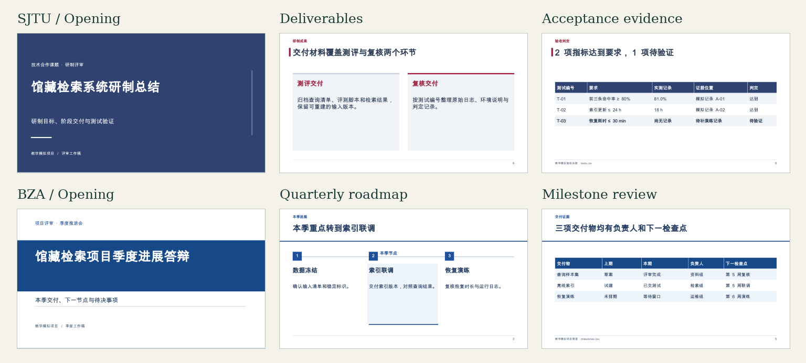

# University decks · 高校与院校模板

| 工作模板 | 为谁准备 | 可编辑样稿 |
|---|---|---|
| 上海交通大学研制总结场景 · Development review | 评审人要从任务目标找到交付物、测试编号、实测记录与判定。九页起稿含章页、环境与基线、验收矩阵和遗留项。 | [下载 SJTU 场景起稿](decks/sjtu-review.pptx) |
| 北京中关村学院季度答辩场景 · Quarterly defense | 评委需要在上季的路线图上定位本季进展。七页起稿保留节点位置，高亮本季节点，随后列出里程碑证据和待决事项。 | [下载 BZA 场景起稿](decks/bza-quarterly.pptx) |

These are original CiteSlide layouts informed by the two reporting settings. Institutional marks and official masters are supplied locally by the user. Importing a licensed school PPTX keeps its original slide order and native objects for targeted text and table edits.

[九所高校与院校的来源和使用命令](../research-deck/references/campuses.md) · [机器可读目录](../research-deck/assets/campuses.json) · [通用风格图册](gallery.md)
