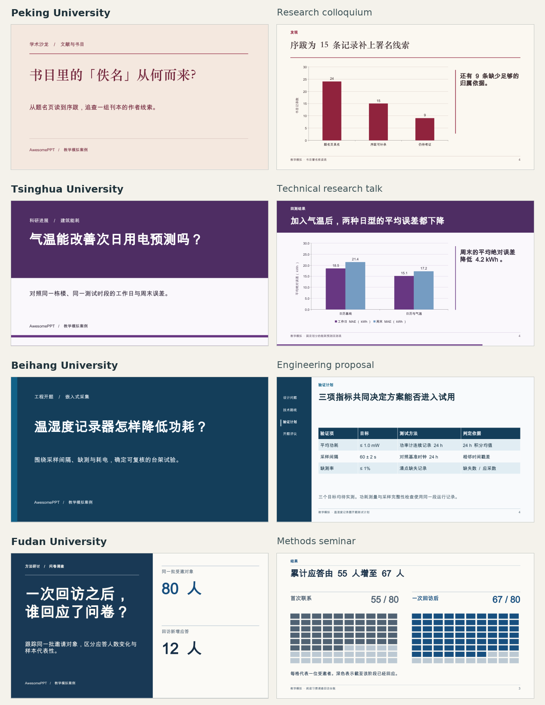

# University decks · 高校与院校模板

## 北大、清华、北航、复旦

左列是封面，右列是同一份报告里的结果或验证页。以下四套为 AwesomePPT 原创的五页教学样稿，含可编辑文字、数据对象与讲者备注。

| 学校与场合 | 成稿中的视觉与叙事 | 下载 |
|---|---|---|
| 北京大学 · 学术沙龙 | 绛红、暖纸色和衬线标题，适合从文献线索讲到定量证据。 | [PPTX](decks/pku-colloquium.pptx) · [PDF](decks/pku-colloquium.pdf) |
| 清华大学 · 科研进展 | 紫色通栏，用分组柱图并排展示基线、实验方法及误差。 | [PPTX](decks/tsinghua-research.pptx) · [PDF](decks/tsinghua-research.pdf) |
| 北京航空航天大学 · 工程开题 | 航蓝章节导航，验证表把目标、测试方法和判定依据放在同一行。 | [PPTX](decks/buaa-proposal.pptx) · [PDF](decks/buaa-proposal.pdf) |
| 复旦大学 · 方法研讨 | 双栏数字封面，同分母方格图展示两轮调查的变化。 | [PPTX](decks/fudan-seminar.pptx) · [PDF](decks/fudan-seminar.pdf) |

从仓库根目录运行 `python research-deck/scripts/deck.py campus 北大 工作稿` 可生成独立逐页稿和 CSV，随后用 `build` 生成 PPTX。需要沿用指定校方文件时，同一命令加 `--template 学校模板.pptx` 即可导入。

## 上海交大与北京中关村学院

| 工作模板 | 为谁准备 | 可编辑样稿 |
|---|---|---|
| 上海交通大学研制总结场景 · Development review | 评审人要从任务目标找到交付物、测试编号、实测记录与判定。九页起稿含章页、环境与基线、验收矩阵和遗留项。 | [下载 SJTU 场景起稿](decks/sjtu-review.pptx) |
| 北京中关村学院季度答辩场景 · Quarterly defense | 评委需要在上季的路线图上定位本季进展。七页起稿保留节点位置，高亮本季节点，随后列出里程碑证据和待决事项。 | [下载 BZA 场景起稿](decks/bza-quarterly.pptx) |

These are original AwesomePPT layouts written for their respective reporting settings. Institutional marks and official masters are supplied locally by the user. Importing a licensed school PPTX keeps its original slide order and native objects for targeted text and table edits.

[十所高校与院校的来源和使用命令](../research-deck/references/campuses.md) · [机器可读目录](../research-deck/assets/campuses.json) · [通用风格图册](gallery.md)
