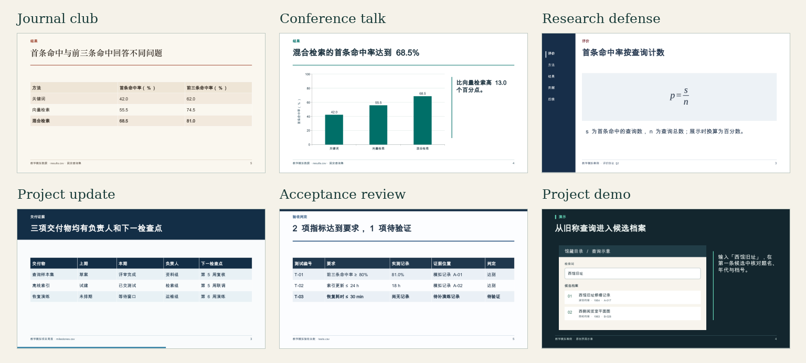

# Template gallery · 模板图册

Each image below comes from the editable starter deck. Choose the question your audience needs answered, then download the corresponding PPTX. The six Chinese decks use an original, illustrative archive-retrieval project.

| Mode · 汇报模式 | Audience question | Default style | Editable deck |
|---|---|---|---|
| Journal club · 文献组会 | Which result supports the claim, and where does it stop holding? | Editorial | [journal-club.pptx](decks/journal-club.pptx) |
| Conference talk · 会议短讲 | Which single finding should the audience remember? | Evidence | [conference.pptx](decks/conference.pptx) |
| Research defense · 研究答辩 | What did the presenter contribute, and how was it tested? | Defense | [defense.pptx](decks/defense.pptx) |
| Project update · 项目推进 | What changed since the last review, and who owns the next decision? | Seminar | [progress.pptx](decks/progress.pptx) |
| Acceptance review · 研制验收 | Which requirements have evidence, and which still need a test? | Review | [acceptance.pptx](decks/acceptance.pptx) |
| Project demo · 项目演示 | Which user task does the demonstration actually complete? | Stage | [demo.pptx](decks/demo.pptx) |

For an English talk based on published measurements, open the [Iris deck](decks/iris.pptx) or its [PDF preview](decks/iris.pdf). For your own work, start from a [mode specification](../research-deck/assets/starters) and choose a [visual style](../research-deck/assets/styles.json).
